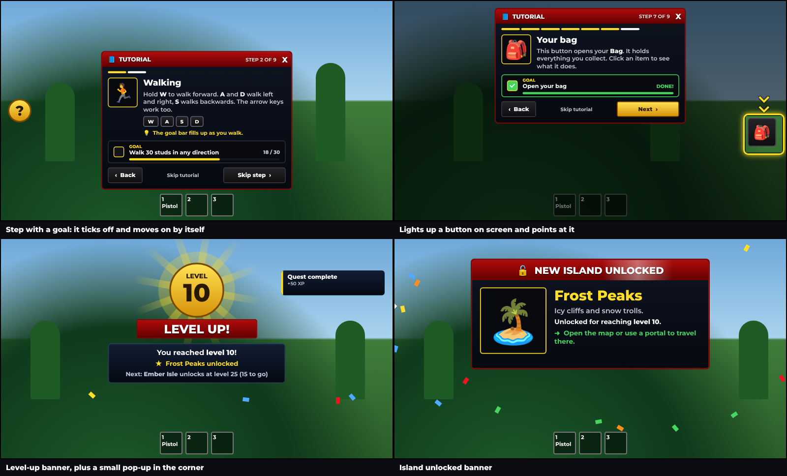

# Jade Jungle Goblins, Quest-style UI, Pistol & Tutorial

This repo has four drop-in packages. Each one is a single file you drag into **ReplicatedStorage** in Roblox Studio:

- **`JadeJungleGoblins.rbxmx`** adds animated goblin enemies (see below).
- **`QuestThemeUI.rbxmx`** restyles your Bag and Tutorial screens to look like the Quests window (see [Quest-style UI](#quest-style-ui)).
- **`RealisticPistol.rbxmx`** adds a detailed, working pistol that every player spawns with (see [Pistol](#pistol)).
- **`TutorialAndAlerts.rbxmx`** adds a step-by-step visual tutorial, plus pop-ups when a player levels up or unlocks an island (see [Tutorial and notifications](#tutorial-and-notifications)).

## Jade Jungle Goblins

Goblin enemies for the Jade Jungle. They're modeled on the classic big-eared goblin: big bald head, angry brows, droopy nose, long ears, red tunic with leather belts, a spiked round shield and a curved scimitar. Each goblin has a real jointed rig, so it runs, swings its sword and flinches instead of sliding around like a block.


*Top: rest pose, idle stance, sword windup, slash. Bottom: one full running stride.*

## What they do

- **Run animation.** A full stride with knee tuck and toe push-off. The body bobs and leans into the run, hips and shoulders twist, and arms swing opposite the legs. The ears and loincloth flop with each step. At wandering speed it slows into a walk.
- **Idle animation.** A crouched, breathing stance with the sword raised. The goblin looks around and its ears twitch.
- **Combat.** Goblins chase players who come near and do an overhead sword slash, which deals damage when the blade lands. They flinch when hit.
- **Death.** The goblin goes limp as a ragdoll, then respawns at its spawn point later.
- **Variety.** Every goblin gets slightly different skin and tunic colours.

The animation runs on each player's computer, so it's smooth and doesn't load the server.

## Install (easiest way)

1. Download `JadeJungleGoblins.rbxmx` from this repo.
2. In Roblox Studio, drag the file into **ReplicatedStorage**. The folder must be in ReplicatedStorage; the scripts inside are set to run from there.
3. Add spawn points:
   - In **Workspace**, make a Folder named `JadeJungle`. Inside it, make a Folder named `GoblinSpawns`.
   - Put Parts in `GoblinSpawns` where the goblins should live. Make them anchored, and set Transparency to 1 and CanCollide to off. Each Part gets one goblin.
   - If you skip this step, 6 goblins spawn around position (0, 10, 0) and a warning appears in Output.
4. Press **Play**.

**Remove your old block entities** (or the script that spawns them) so they don't run alongside these.

## Settings

Open `JadeJungleGoblins > Config` to change:

| Setting | What it does |
| --- | --- |
| `Scale` | Goblin size (1.1 ≈ a bit shorter than a player) |
| `MaxHealth`, `AttackDamage`, `AttackCooldown` | How tough and dangerous goblins are |
| `WanderSpeed`, `ChaseSpeed` | Movement speed |
| `AggroRange`, `LeashRange`, `WanderRadius` | How far they notice players, chase them and roam |
| `RespawnTime`, `MaxGoblins`, `GoblinsPerSpawn` | Population |

## Files

All files are in `src/JadeJungleGoblins/`:

- `GoblinBuilder.luau` builds the goblin model and its 17-joint rig.
- `GoblinAnimator.luau` contains the procedural run, idle, attack and flinch animation.
- `GoblinAnimate.client.luau` animates every goblin on each player's screen.
- `GoblinSpawner.server.luau` handles spawning, AI, damage, ragdolls and respawning.
- `Config.luau` holds the settings above.

If you edit the source files, rebuild the Studio file with `python3 tools/build_rbxmx.py`. Rojo users can `rojo serve` the included `default.project.json` instead (Rojo 7.4+).

## Want it even more realistic?

These goblins are built from smooth rounded parts, so they look like the reference picture but not like a sculpted, textured model. To get a photo-quality look, import a goblin **MeshPart** model (from Blender or the Toolbox) and name its joints like this rig's. The animation code drives any model with the same joint names: `Root`, `Waist`, `Neck`, `Left/RightShoulder`, `Left/RightElbow`, `Left/RightHip`, `Left/RightKnee`, `Left/RightAnkle`, `Left/RightEar`, `FrontFlap`, `BackFlap`.

## Quest-style UI

`QuestThemeUI.rbxmx` gives your **Bag** and **Tutorial** screens the look of the Quests window:

- dark navy window with a red border and a red gradient title bar
- dark blue cards and near-black item slots
- dark tab and action buttons
- rounded progress bars
- bold white text, grey descriptions, yellow XP and a red close X


*Example run on mock Bag and Tutorial screens: before on the left, after on the right.*

**Install:** drag `QuestThemeUI.rbxmx` into **ReplicatedStorage** and press Play.

**How it works:** when the game runs, the script finds every ScreenGui whose name contains `bag`, `inventory`, `backpack` or `tutorial`. It restyles whatever is inside: colours, fonts, outlines, gradients and rounded corners. It never moves or resizes anything, so your layout and your own scripts keep working. Items added to the bag later get styled automatically.

- **Your screens are named differently?** Edit the `TARGET_GUIS` list at the top of the `ApplyQuestTheme` script.
- **Want to keep one element exactly as it was?** Give it the attribute `NoTheme` = `true`.
- **Changes only show in Play mode,** not while you're editing in Studio.

## Pistol

`RealisticPistol.rbxmx` adds a detailed polymer-frame handgun that every player spawns with.


*Three views of the pistol, plus the reload animation (bottom right): slide locked back, magazine dropping out.*

**Install:** drag `RealisticPistol.rbxmx` into **ReplicatedStorage** and press Play. The pistol shows up in your hotbar. Click or tap to shoot, and press **R** (or the on-screen button on mobile) to reload.

**What it does:**
- **Model.** Steel slide with rear serrations, an ejection port showing the barrel, sights with white dots, an accessory rail, a squared trigger guard, a bladed trigger, an angled grip with stippled panels and a removable magazine.
- **Animation.** The slide moves back on every shot and locks back when the gun is empty, and the trigger pulls. On reload, the magazine drops out and a new one goes in.
- **Effects.** Muzzle flash with a light, smoke, flying brass casings, bullet tracers, sparks and bullet holes where shots land, and camera recoil.
- **HUD.** A crosshair that spreads as you fire, a hit marker (red for headshots), an ammo counter with a reload bar, and a reload button on mobile.
- **Fair play.** The server checks ammo, fire rate and range, and deals the damage, so players can't cheat them. Headshots do double damage, and it works on the goblins too.

**Settings:** open `RealisticPistol > Config` to change damage, magazine size, fire rate, reload time, recoil, spread, full-auto mode, team damage and size.

**Sounds:** Roblox doesn't include gun sounds, so the pistol is silent until you add some. Find sounds in the Creator Store (search "pistol shot", "pistol reload", "dry fire") and paste their IDs into `Config.Sounds`, like `Fire = "rbxassetid://123456"`.

**Don't want everyone to spawn with it?** Set `GiveOnSpawn = false`. The tool then sits in the `RealisticPistol` folder for you to give out yourself, for example from a shop.

## Tutorial and notifications

`TutorialAndAlerts.rbxmx` adds a guided tutorial that explains the game one step at a time. It also shows a big banner whenever a player levels up or unlocks a new island.



*Mock-up of the tutorial card, a highlighted button, the level-up banner with a pop-up, and the island banner.*

**Install:** drag `TutorialAndAlerts.rbxmx` into **ReplicatedStorage** and press Play. The tutorial opens a couple of seconds after a new player spawns.

### The tutorial

Each step is a card with:
- **An icon and a short explanation** of one thing (walking, jumping, the camera, the pistol, goblins, the bag, quests, levels and islands).
- **Text for the player's device.** Keyboard, phone and controller players each see their own controls, drawn as keycaps like `W` `A` `S` `D`. If a player switches device mid-step, the card updates.
- **A goal to try**, like "Walk 30 studs" or "Open your bag". The goal box has a progress bar and ticks green when it's done, then the tutorial moves on by itself. Players can always press **Skip step** if they don't want to do it.
- **Highlights.** Steps about a button dim the screen, put a pulsing gold ring around the button and point an arrow at it. Steps about something in the world (like the goblins) put a marker over it with its distance and draw a gold trail to it. When the target is off screen, an arrow on the screen edge shows which way to turn.
- **A progress bar** ("Step 3 of 9") plus Back, Next and Skip buttons. Skipping asks to confirm first.

The tutorial only shows once per player; finishing or skipping it is saved in a DataStore. The round **?** button on the left replays it anytime. Steps for things your game doesn't have (no pistol, no bag button, no goblins) are left out automatically.

**Your old tutorial screen** is hidden so two tutorials don't show at once (any ScreenGui with "tutorial" in its name). Set `Tutorial.HideOldTutorial = false` in Config to keep it.

**Change the steps** in `TutorialAndAlerts > Config > Steps`. Each step's options are explained at the top of the file. You can add your own steps with goals like `Move`, `Jump`, `Look`, `Equip`, `Open`, `Reach` and `Level`.

**Saving in Studio:** DataStores only work in Studio if you turn on **Game Settings > Security > Enable Studio Access to API Services**. Without it the tutorial still works, but shows on every visit.

### Level-up and island notifications

- **Level up:** a gold badge with the new level, spinning light rays, confetti and a "LEVEL UP!" ribbon. Below it, a card says what the player reached, lists any rewards for that level, and says which island unlocks next and how many levels to go.
- **Island unlocked:** a "NEW ISLAND UNLOCKED" window with the island's picture, name, description, the level that unlocked it and how to get there.
- **Small pop-ups** in the top-right corner, for example "Tutorial complete!". Your own scripts can show these too.

Banners wait their turn, so a level-up that also unlocks an island shows one after the other.

**How it finds the level:** it looks for a `Level` attribute on the player, a `Level` value in `leaderstats`, or a `Level` value anywhere else under the player (like a `Data` folder). If yours has another name, add it to `LevelNames` in Config. Data that loads in the first few seconds after joining doesn't count as a level up, so returning players don't get a banner for their saved level.

**Set up your islands** in `Config.Islands`, with the level that unlocks each one:

```lua
Config.Islands = {
	{ Name = "Jade Jungle", Level = 1, Description = "Overgrown ruins full of goblins." },
	{ Name = "Frost Peaks", Level = 10, Description = "Icy cliffs and snow trolls.", Image = "rbxassetid://123456" },
}
```

Islands are also detected automatically if your game stores unlocks as a true/false attribute with "island" in its name (like `Island_FrostPeaks`), or as values in a folder with "island" in its name (like `UnlockedIslands > Frost Peaks`).

**Show them from your own scripts** (for example when an island is unlocked by a quest instead of a level):

```lua
local Notify = require(game.ReplicatedStorage.TutorialAndAlerts.Notify)
Notify.IslandUnlocked(player, "Frost Peaks")
Notify.LevelUp(player, 12)
Notify.Toast(player, "Quest complete", "+50 XP")
Notify.ShowTutorial(player) -- replay the tutorial
```

The same banner never shows twice, so it's fine if both your script and the automatic detection spot the same change.

**Settings:** `Config` also has level rewards (`LevelRewards`), how long banners stay up, confetti on or off, and sound IDs for level-ups, islands, pop-ups and finished tutorial goals.
