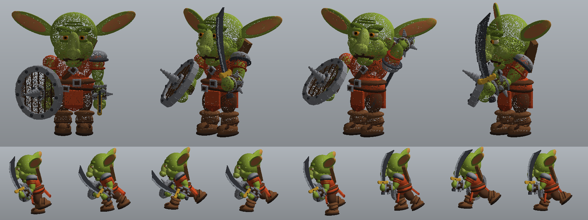
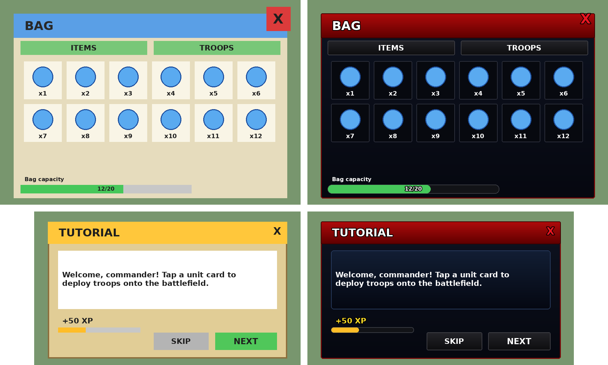
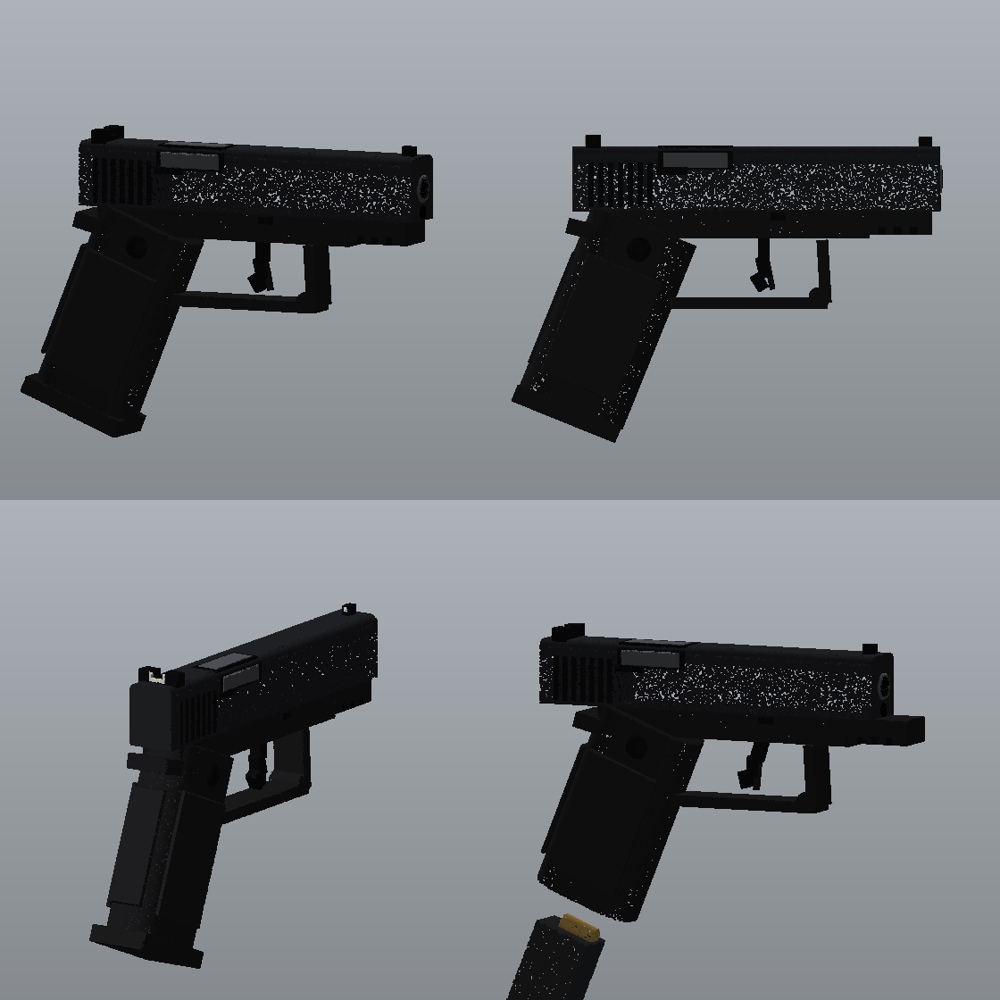
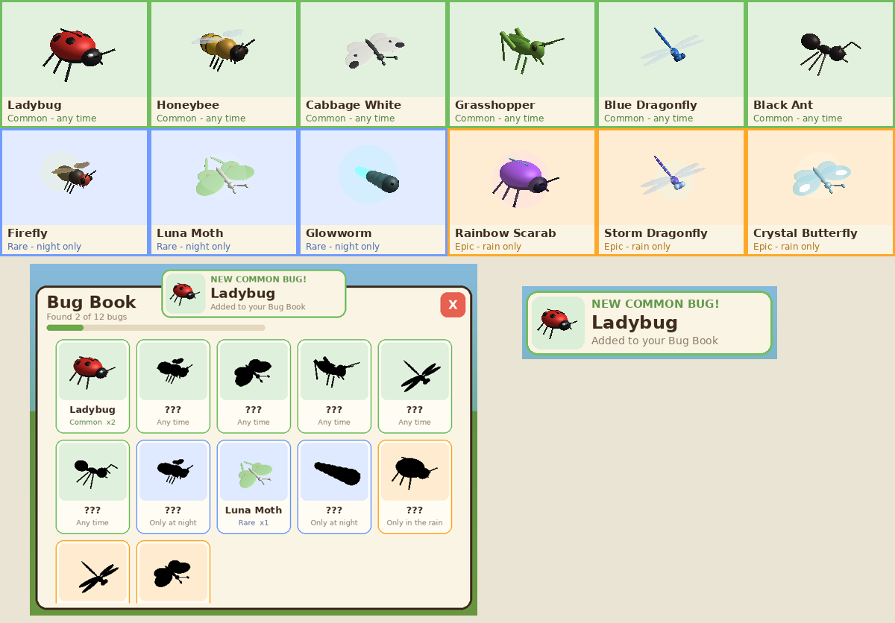

# Jade Jungle Goblins, Quest-style UI, Pistol & Bug Catcher

This repo has four drop-in packages. Each one is a single file you drag into **ReplicatedStorage** in Roblox Studio:

- **`JadeJungleGoblins.rbxmx`** adds animated goblin enemies (see below).
- **`QuestThemeUI.rbxmx`** restyles your Bag and Tutorial screens to look like the Quests window (see [Quest-style UI](#quest-style-ui)).
- **`RealisticPistol.rbxmx`** adds a detailed, working pistol that every player spawns with (see [Pistol](#pistol)).
- **`BugCatcher.rbxmx`** is a complete bug-catching game: a meadow, day and night, rain, 12 bugs, a net, a Bug Book and saving (see [Bug Catcher](#bug-catcher)).

## Jade Jungle Goblins

Goblin enemies for the Jade Jungle. They're modeled on the classic big-eared goblin: big bald head, angry brows, droopy nose, long ears, red tunic with leather belts, a spiked round shield and a curved scimitar. Each goblin has a real jointed rig, so it runs, swings its sword and flinches instead of sliding around like a block.

*Top: rest pose, idle stance, sword windup, slash. Bottom: one full running stride.*

## What they do

- **Run animation.** A full stride with knee tuck and toe push-off. The body bobs and leans into the run, hips and shoulders twist, and arms swing opposite the legs. The ears and loincloth flop with each step. At wandering speed it slows into a walk.
- **Idle animation.** A crouched, breathing stance with the sword raised. The goblin looks around and its ears twitch.
- **Combat.** Goblins chase players who come near and do an overhead sword slash, which deals damage when the blade lands. They flinch when hit.
- **Death.** The goblin goes limp as a ragdoll, then respawns at its spawn point later.
- **Variety.** Every goblin gets slightly different skin and tunic colours.

The animation runs on each player's computer, so it's smooth and doesn't load the server.

## Install (easiest way)

1. Download `JadeJungleGoblins.rbxmx` from this repo.
2. In Roblox Studio, drag the file into **ReplicatedStorage**. The folder must be in ReplicatedStorage; the scripts inside are set to run from there.
3. Add spawn points:
   - In **Workspace**, make a Folder named `JadeJungle`. Inside it, make a Folder named `GoblinSpawns`.
   - Put Parts in `GoblinSpawns` where the goblins should live. Make them anchored, and set Transparency to 1 and CanCollide to off. Each Part gets one goblin.
   - If you skip this step, 6 goblins spawn around position (0, 10, 0) and a warning appears in Output.
4. Press **Play**.

**Remove your old block entities** (or the script that spawns them) so they don't run alongside these.

## Settings

Open `JadeJungleGoblins > Config` to change:

| Setting | What it does |
| --- | --- |
| `Scale` | Goblin size (1.1 ≈ a bit shorter than a player) |
| `MaxHealth`, `AttackDamage`, `AttackCooldown` | How tough and dangerous goblins are |
| `WanderSpeed`, `ChaseSpeed` | Movement speed |
| `AggroRange`, `LeashRange`, `WanderRadius` | How far they notice players, chase them and roam |
| `RespawnTime`, `MaxGoblins`, `GoblinsPerSpawn` | Population |

## Files

All files are in `src/JadeJungleGoblins/`:

- `GoblinBuilder.luau` builds the goblin model and its 17-joint rig.
- `GoblinAnimator.luau` contains the procedural run, idle, attack and flinch animation.
- `GoblinAnimate.client.luau` animates every goblin on each player's screen.
- `GoblinSpawner.server.luau` handles spawning, AI, damage, ragdolls and respawning.
- `Config.luau` holds the settings above.

If you edit the source files, rebuild the Studio file with `python3 tools/build_rbxmx.py`. Rojo users can `rojo serve` the included `default.project.json` instead (Rojo 7.4+).

## Want it even more realistic?

These goblins are built from smooth rounded parts, so they look like the reference picture but not like a sculpted, textured model. To get a photo-quality look, import a goblin **MeshPart** model (from Blender or the Toolbox) and name its joints like this rig's. The animation code drives any model with the same joint names: `Root`, `Waist`, `Neck`, `Left/RightShoulder`, `Left/RightElbow`, `Left/RightHip`, `Left/RightKnee`, `Left/RightAnkle`, `Left/RightEar`, `FrontFlap`, `BackFlap`.

## Quest-style UI

`QuestThemeUI.rbxmx` gives your **Bag** and **Tutorial** screens the look of the Quests window:

- dark navy window with a red border and a red gradient title bar
- dark blue cards and near-black item slots
- dark tab and action buttons
- rounded progress bars
- bold white text, grey descriptions, yellow XP and a red close X

*Example run on mock Bag and Tutorial screens: before on the left, after on the right.*

**Install:** drag `QuestThemeUI.rbxmx` into **ReplicatedStorage** and press Play.

**How it works:** when the game runs, the script finds every ScreenGui whose name contains `bag`, `inventory`, `backpack` or `tutorial`. It restyles whatever is inside: colours, fonts, outlines, gradients and rounded corners. It never moves or resizes anything, so your layout and your own scripts keep working. Items added to the bag later get styled automatically.

- **Your screens are named differently?** Edit the `TARGET_GUIS` list at the top of the `ApplyQuestTheme` script.
- **Want to keep one element exactly as it was?** Give it the attribute `NoTheme` = `true`.
- **Changes only show in Play mode,** not while you're editing in Studio.

## Pistol

`RealisticPistol.rbxmx` adds a detailed polymer-frame handgun that every player spawns with.

*Three views of the pistol, plus the reload animation (bottom right): slide locked back, magazine dropping out.*

**Install:** drag `RealisticPistol.rbxmx` into **ReplicatedStorage** and press Play. The pistol shows up in your hotbar. Click or tap to shoot, and press **R** (or the on-screen button on mobile) to reload.

**What it does:**
- **Model.** Steel slide with rear serrations, an ejection port showing the barrel, sights with white dots, an accessory rail, a squared trigger guard, a bladed trigger, an angled grip with stippled panels and a removable magazine.
- **Animation.** The slide moves back on every shot and locks back when the gun is empty, and the trigger pulls. On reload, the magazine drops out and a new one goes in.
- **Effects.** Muzzle flash with a light, smoke, flying brass casings, bullet tracers, sparks and bullet holes where shots land, and camera recoil.
- **HUD.** A crosshair that spreads as you fire, a hit marker (red for headshots), an ammo counter with a reload bar, and a reload button on mobile.
- **Fair play.** The server checks ammo, fire rate and range, and deals the damage, so players can't cheat them. Headshots do double damage, and it works on the goblins too.

**Settings:** open `RealisticPistol > Config` to change damage, magazine size, fire rate, reload time, recoil, spread, full-auto mode, team damage and size.

**Sounds:** Roblox doesn't include gun sounds, so the pistol is silent until you add some. Find sounds in the Creator Store (search "pistol shot", "pistol reload", "dry fire") and paste their IDs into `Config.Sounds`, like `Fire = "rbxassetid://123456"`.

**Don't want everyone to spawn with it?** Set `GiveOnSpawn = false`. The tool then sits in the `RealisticPistol` folder for you to give out yourself, for example from a shop.

## Bug Catcher

`BugCatcher.rbxmx` is a complete bug-catching game. Chase bugs around a sunny meadow, swing your net, and fill your Bug Book.

*Top: all 12 bugs. Bottom: the Bug Book (uncaught bugs are black silhouettes) and the popup you get when you catch a bug.*

**Install:**

1. Start from a new **Baseplate** place.
2. Drag `BugCatcher.rbxmx` into **ReplicatedStorage**.
3. Optional: select **Workspace > Terrain** and turn on **Decoration** so the grass sways. Scripts can't switch this on for you.
4. Optional: to test saving in Studio, publish the place and turn on **Game Settings > Security > Enable Studio Access to API Services**. Without it, the game still works and tells you that saving is off.
5. Press **Play**.

The game deletes the template's grey `Baseplate` part so it doesn't cover the grass. Set `RemoveBaseplate = false` to keep it.

**How to play:**

- You start holding a bug net. **Click** (PC), **tap** (mobile) or press the **trigger** (gamepad) to swing it. Any bug inside the net when it lands is caught.
- Bugs run or fly away when you get close, so sneak up and swing fast.
- Press the **book button** on the right of the screen, or **B**, to open your Bug Book. Bugs you haven't caught are black silhouettes with a hint about when they appear. Caught bugs are shown in colour with their name and how many you've caught.
- A popup appears every time you catch a bug, with a fanfare for new ones.

**Bugs:**

| Rarity | When | Bugs |
| --- | --- | --- |
| Common | Any time | Ladybug, Honeybee, Cabbage White, Grasshopper, Blue Dragonfly, Black Ant |
| Rare (glows) | Only at night | Firefly, Luna Moth, Glowworm |
| Epic (glows) | Only in the rain | Rainbow Scarab, Storm Dragonfly, Crystal Butterfly |

Rare bugs leave when the sun comes up, and Epic bugs leave when the rain stops.

**What's included:**

- **The meadow.** A grass field ringed by rolling hills, with patches of flowers, grass tufts, bushes, rocks and trees. It's generated from a seed, so every server looks the same.
- **Lighting.** Soft shadows, light fog and colour grading that blend smoothly between day, sunset, night and rain.
- **Day and night.** A full day lasts 10 minutes: 6 minutes of day and 4 of night.
- **Rain.** Every 40 seconds there's a 30% chance of a shower lasting 50 to 100 seconds, with falling rain, splashes on the grass, darker clouds and a rain sound.
- **Smooth bugs.** Bugs fly or crawl, flap their wings, scuttle their legs and lean into turns. Each bug is drawn on every player's screen, so it moves smoothly.
- **Sounds.** Footsteps on the grass, rain, the net swing and catching a bug.
- **Fair play.** The server moves the bugs and does every catch check. A player can only catch bugs that are really in front of them, while alive and holding the net, and no faster than the net swings.
- **Saving.** Each player's Bug Book is saved with DataStore when they leave, every 90 seconds and when the server shuts down. Saves only ever add catches, so old catches are never lost.
- **PC and mobile.** Large touch-friendly buttons, and the Bug Book shrinks to fit phone screens.

**Settings:** open `BugCatcher > Config` to change:

| Setting | What it does |
| --- | --- |
| `FieldRadius`, `Seed` | Size of the meadow and the random layout |
| `TreeCount`, `BushCount`, `RockCount`, `FlowerPatches`, `GrassTufts` | How much scenery there is |
| `DayMinutes`, `NightMinutes`, `StartClockTime` | Length of day and night, and the time when the server starts |
| `RainCheckSeconds`, `RainChance`, `RainSeconds` | How often it rains and for how long |
| `MaxCommonBugs`, `MaxRareBugs`, `MaxEpicBugs`, `SpawnInterval` | How many bugs there are and how fast they appear |
| `SwingCooldown`, `NetReach`, `NetRadius`, `NetHeight` | Swing speed and how big the catching area is |
| `DataStoreName`, `AutosaveSeconds` | Where and how often collections are saved |
| `Sounds`, `FootstepVolume`, `RainVolume` | Sound IDs and volumes |

To add a bug, add an entry to `BugData` with one of the existing body shapes. Bug speed and how easily each rarity gets scared are also set in `BugData`.

**Sounds:** the footsteps, net swing and catch sounds are built into Roblox, and the rain is a free sound from the Roblox library. To use your own, paste a sound ID into `Config.Sounds`, like `Rain = "rbxassetid://123456"`.

**Files** (in `src/BugCatcher/`):

- `WorldServer.server.luau` builds the meadow, sets up the lighting, and starts the clock and the weather.
- `WorldClient.client.luau` handles the sky, lighting blends, rain and footsteps on each player's screen.
- `BugServer.server.luau` spawns and moves the bugs, gives out nets and checks catches.
- `BugVisuals.client.luau` draws and animates the bugs.
- `NetClient.client.luau` handles swinging the net, its animation and sounds.
- `BookClient.client.luau` contains the Bug Book and the catch popup.
- `Collection.luau` stores, loads and saves each player's collection.
- `FieldBuilder.luau`, `BugBuilder.luau` and `NetBuilder.luau` build the meadow, the bugs and the net.
- `BugData.luau` lists the bugs. `Environment.luau` keeps the shared clock and weather. `Config.luau` holds the settings. `Util.luau` holds small helpers.

**Checking scripts:** `python3 tools/check_luau.py src --api Full-API-Dump.json` checks every script for syntax errors, typos in variable names, and wrong Roblox class, property, method and Enum names. Download the API dump from [Roblox-Client-Tracker](https://github.com/MaximumADHD/Roblox-Client-Tracker) (`Full-API-Dump.json`). Without `--api`, it only checks syntax and variable names.
